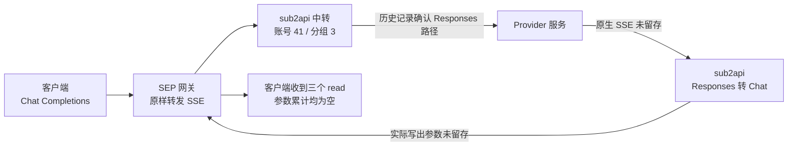

# 工具调用参数丢失排查报告

排查日期：2026-10-29。本文默认使用北京时间（UTC+08:00），明确标注 UTC 的时间除外。

## 一、结论

**已确认实际调用链，并找到中转中可能丢失工具参数的具体代码；但本次缺少上游原始事件和下游逐帧记录，尚不能确定参数第一次在哪一层消失。**

1. **实际经过 Chat Completions → Responses → Chat Completions 转换。** 历史记录关联 sub2api 账号 41、分组 3，上游接口路径为 `/v1/responses`。
2. **已确认转换器存在参数处理缺口。** 它转发工具开始事件和参数增量，但不从 `function_call_arguments.done`、`output_item.done` 或最终完整快照补取参数。如果完整参数仅出现在这些位置，下游可能只收到工具名称、ID 和 `arguments: ""`，随后正常返回 `tool_calls`。
3. **上述代码行为与客户端现象吻合，但尚未证明本次命中。** 本次没有原始增量证据，无法区分“Provider 返回时已经为空”和“Provider 有参数但转换后为空”。
4. **未发现 SEP 网关主动删除或覆盖参数的代码，也没有本次取消、超时或异常截断的日志证据。** 这不能替代历史逐帧内容对照。
5. **不能认定模型本身生成了空参数。** 即使后续确认 Provider 返回为空，其服务后面仍可能存在代理和协议转换。

本轮只读取代码、配置和已有日志，没有修改业务代码、没有重放请求、没有调整模型参数、没有运行测试或发起新的模型调用。本文档是核查结束后的整理产物。

## 二、定位信息与实际路由

| 项目 | 核查结果 |
| --- | --- |
| 平台请求 ID | `df604473-b4db-41ca-9952-829e08b732d8` |
| 用户任务 | 给我一次性袜子的策划案 |
| 客户端模型标识 | `gpt-5.6-luna` |
| 首个工具调用 | `call_4166260f8e184e36865f330d4f5cd836`，工具名 `read` |
| 请求时间 | 2026-10-29 北京时间约 **14:00:06–14:00:29**，对应 UTC **06:00:06–06:00:29** |
| SEP 入口 | `longdaosep.cn`，`/api/gateway/v1/chat/completions` |
| SEP 执行记录 | `cmvt4waak0fprn7012vn0lt1n` |
| 中转关联 ID | `dbdfecd7-0c79-459f-ba1f-4d8b9e98a3de` |
| 中转历史路由 | `account_id=41`、`group_id=3`、`platform=openai` |
| 历史协议记录 | `inbound_endpoint=/v1/chat/completions`，`upstream_endpoint=/v1/responses` |
| 历史模型记录 | `requested_model`、`model` 均为 `gpt-5.6-luna`；`upstream_model`、`model_mapping_chain` 未记录 |
| 当前账号配置 | 名称“脑圣云gpt”，API Key 类型；主机 `api.naoshengyun.com`；模型同名映射，Responses 支持为 true，`proxy_id=null` |
| 当前配置的证据边界 | 账号更新时间晚于事发，不能用当前配置直接证明历史出站主机、模型或代理配置 |
| SEP 结束记录 | `finishReason=tool_calls`、`done=true`、`status=SETTLED`、`errorCode=null` |

`platform=openai` 是适配协议类别，不能据此判断实际模型供应商是 OpenAI。脑圣云后面的真实模型部署、代理和内部转换链，现有证据无法确认。

当前配置配合出站 URL 拼接代码，对应的目标路径应为 `/v1/responses`；历史使用该路径有账单记录支持，但完整历史出站 URL 和最终模型字段没有独立捕获。



## 三、客户端已经确认的事实

以下依据用户提供的客户端核查结果，本轮未取得原始客户端帧：

- 客户端发出的 `read` 工具 Schema 存在，必填字段为 `path`。
- 收到的工具调用存在 `arguments` 字段；汇总全部片段后，参数文本长度为 **0**，是空字符串 `""`，不是字面量 `"{}"`。
- SDK 收到的参数片段同样为空，最终参数对象为 `{}`。
- 同一次响应有三个 `read` 调用，参数全部为空，因缺少 `path` 校验失败，没有真正执行文件读取。
- 响应结束原因为 `tool_calls`，存在 `[DONE]`，客户端未发现 SSE 帧异常或采集截断。

不能只看工具开始事件中的空参数。本次客户端结论依据的是完整响应片段汇总。

## 四、逐层参数证据表

表中 T1 指 `call_4166260f8e184e36865f330d4f5cd836`。其余两次工具调用的 ID/index 未提供，不能擅自补成 1、2。

**“未知”表示没有留存证据，不表示长度为零。**

| 检查位置 | 调用 ID/index | 字段是否存在 | 累计参数长度 | 参数状态 | 结束状态 | 日志或代码证据 |
| --- | --- | --- | --- | --- | --- | --- |
| Provider → sub2api，转换前原生 SSE | T1 及另两次；原生 index 未知 | 未知 | 未知 | 无法区分字段缺失、null、空串、`"{}"`、有效 JSON、非法或截断 JSON | 原生终态未留存 | 中转文件日志、运维日志均无逐工具事件 |
| sub2api 转换后的内存 chunks | 同上 | 历史实际值未知 | 未知 | 代码会生成空参数身份帧，但无法据此还原最终累计结果 | 下游最终为 `tool_calls` | 转换器代码；无本次逐调用摘要 |
| sub2api 实际写入下游 | 同上 | 未知 | 未知 | 未保存实际写出的参数片段 | HTTP 200、请求正常完成记录 | 只有请求级日志，不能代替写出内容 |
| SEP 接收并写入响应 | 同上 | 未知 | 未知 | 未保存参数片段；代码原样转发字节 | `tool_calls`、`[DONE]` | 累计转交 pipeline 16412 字节；不是参数长度，也不是客户端收妥字节证明 |
| 客户端汇总全部 SSE 片段 | T1 / index 未提供 | 有 `arguments` | **0** | **空字符串 `""`，不是 `"{}"`** | `tool_calls`、`[DONE]` | 用户提供的客户端证据 |
| 客户端汇总全部 SSE 片段 | 另两次 read / ID、index 未提供 | 按客户端记录为有 | **各 0** | 空字符串 | 同上 | 用户提供的客户端证据 |
| SDK 解析及工具校验 | 三次 read | 最终参数对象存在 | 参数文本各 0 | 对象为 `{}`，缺少 `path` | 校验失败，未实际读取文件 | 用户提供的 SDK 证据 |

## 五、代码检查结果

### A. 发给上游的请求

**未发现主动删除 `required: ["path"]` 的代码。**

SEP 对符合共享 Schema 的工具定义进行校验，保留 `name`、`description`、`parameters` 和 `strict`。参数 Schema 中的属性与 `required` 不会被收窄为固定字段。

sub2api 将 Chat 工具定义转换为 Responses 工具定义时，把完整的 `Parameters` JSON 直接赋值。存在的转换包括工具结构扁平化，以及未指定 `strict` 时补 `false`；显式值保持。本轮没有调整这些设置。

| 代码位置 | 核查内容 |
| --- | --- |
| [SEP shared/index.ts:1948](../../backend/src/shared/index.ts#L1948) | 工具定义校验，保留 parameters 与 strict |
| [SEP gateway.service.ts:169](../../backend/src/modules/gateway/gateway.service.ts#L169) | 将准备后的 DTO 序列化，POST 至 sub2api `/chat/completions` |
| [sub2api types.go:629](../../../sub2api/backend/internal/pkg/apicompat/types.go#L629) | `Parameters` 使用 `json.RawMessage` |
| [chatcompletions_to_responses.go:418](../../../sub2api/backend/internal/pkg/apicompat/chatcompletions_to_responses.go#L418) | 完整复制函数名和参数 Schema |
| [同文件:450](../../../sub2api/backend/internal/pkg/apicompat/chatcompletions_to_responses.go#L450) | 未指定 strict 时补 false |
| [openai_gateway_chat_completions.go:171](../../../sub2api/backend/internal/service/openai_gateway_chat_completions.go#L171) | Chat → Responses、最终模型赋值、序列化出站 body |
| [openai_gateway_forward.go:967](../../../sub2api/backend/internal/service/openai_gateway_forward.go#L967) | 按账号类型和 Base URL 构建实际出站请求 |

**限制：**没有本次历史入口和出站 body，不能逐字段证明当时发给 Provider 的工具 Schema 完整，也不能确认 Provider 内部是否继续转换或过滤。

### B. 网关接收原生响应的位置

sub2api 在 `handleChatStreamingResponse` 中扫描 Provider 原生 SSE，再解码为 `ResponsesStreamEvent`。本轮已经检查原生参数字段和事件，而不只是搜索 Chat 的 `arguments`：

- `response.output_item.added` 中的 `item.arguments`；
- `response.function_call_arguments.delta` 中的 `delta`；
- `response.function_call_arguments.done` 中的 `arguments`；
- `response.output_item.done` 中的 `item.arguments`；
- 最终响应 `response.output[]` 中的函数调用参数。

实际解码位置：[openai_gateway_chat_completions.go:589](../../../sub2api/backend/internal/service/openai_gateway_chat_completions.go#L589)。

本次日志没有保存这些原始事件，因此无法按调用 ID/index 汇总 Provider 实际返回的所有参数片段。

### C. Provider 适配及协议转换

当前转换行为如下：

```text
output_item.added
  → 按 output_index 注册 Chat 工具索引
  → 输出工具 ID、名称，arguments 默认是空字符串

function_call_arguments.delta
  → 只有 output_index 已注册且 delta 非空，才转发参数片段

function_call_arguments.done / output_item.done
  → 不补取完整参数

最终 completed 快照
  → 处理结束原因和用量，不补取 output 中的完整参数
```

| 已确认的代码行为 | 位置 | 与本次的关系 |
| --- | --- | --- |
| 事件分派处理 added、delta、terminal，但不消费参数 done/item done | [responses_to_chatcompletions.go:145](../../../sub2api/backend/internal/pkg/apicompat/responses_to_chatcompletions.go#L145) | 若上游只在完成快照给参数，下游可能为空；本次是否如此未知 |
| added 注册索引，输出身份帧但不取 `item.arguments` | [同文件:247](../../../sub2api/backend/internal/pkg/apicompat/responses_to_chatcompletions.go#L247) | 下游存在 `arguments: ""` 不代表上游该字段原本为空 |
| delta 早于注册、索引未注册时直接忽略，无 call_id/item_id 补救映射 | [同文件:271](../../../sub2api/backend/internal/pkg/apicompat/responses_to_chatcompletions.go#L271) | 有参数也可能被忽略；本次事件顺序未知 |
| terminal 只处理结束原因和用量，不恢复参数 | [同文件:299](../../../sub2api/backend/internal/pkg/apicompat/responses_to_chatcompletions.go#L299) | 正常 `tool_calls` 不能证明参数完整 |

未发现这条转换路径把非法参数 JSON 解析后主动替换成 `{}` 的逻辑。它主要转发字符串，未对累计工具参数做 JSON 完整性校验。事件本身解码失败时会记录警告并跳过；本次关联日志中未找到这类警告。

另外，普通 Responses 参数字段使用 Go `string`。解码后，原字段缺失、JSON null、空字符串可能都成为空值；不能只看该内存对象区分原始状态。下游 Chat 的 `Arguments` 没有 `omitempty`，所以身份帧会明确序列化为 `arguments: ""`。

证据：[types.go:323](../../../sub2api/backend/internal/pkg/apicompat/types.go#L323)、[types.go:542](../../../sub2api/backend/internal/pkg/apicompat/types.go#L542)、[types.go:646](../../../sub2api/backend/internal/pkg/apicompat/types.go#L646)。

### D. 实际写入客户端的位置

sub2api 的顺序为：转换事件 → 序列化 SSE → 直接写入或加入 `pendingSSE` → 释放 pending → flush → 结束时写 `[DONE]`。

- 转换、序列化和实际写入：[openai_gateway_chat_completions.go:699](../../../sub2api/backend/internal/service/openai_gateway_chat_completions.go#L699)。
- pending 释放与最终 `[DONE]`：[同文件:748](../../../sub2api/backend/internal/service/openai_gateway_chat_completions.go#L748)。

现有转换审计在实际写入前观察内存 chunk，不能作为成功写入的证据。其工具字节统计还是“函数名 + 参数”的合计，不是纯参数长度；并且只有命中特定 suspicious 条件才落日志，空工具参数本身不是充分触发条件。

证据：[openai_chat_conversion_audit.go:143](../../../sub2api/backend/internal/service/openai_chat_conversion_audit.go#L143)、[同文件:203](../../../sub2api/backend/internal/service/openai_chat_conversion_audit.go#L203)、[同文件:264](../../../sub2api/backend/internal/service/openai_chat_conversion_audit.go#L264)。

SEP 接收到中转响应后，通过 Node pipeline 将 chunk 原样写入 Express `res`。观察器只提取用量、finish reason、DONE 和错误信息，不重新拼接、重写工具参数。

证据：[gateway.controller.ts:187](../../backend/src/modules/gateway/gateway.controller.ts#L187)。

**本次没有逐工具的实际写出日志，无法把 Provider 原始参数与中转写出参数逐项对齐。**

### E. 取消、超时、重试与结束事件

- 本次 SEP 记录正常流结束，执行状态 SETTLED、无错误码；中转错误表没有关联记录。
- 查询关联日志及事发附近中转警告/错误日志，未发现对应取消、超时、解析错误或重试证据。
- 中转扫描到 EOF、单独 `[DONE]`、scanner error 或超时时，实际调用链会返回不完整流错误。不能根据孤立收尾 helper 的默认值，推断断流被包装成成功。
- 正常 terminal 已设置 `Finalized`，后续 finalize helper 不会再额外生成一次结束原因。
- 代码在收到 terminal 后结束该响应的处理；本次原始事件序列未留存，不能验证 Provider 是否在终态前已完整交付参数。
- SEP 网关这段链路未发现自动重试/fallback；现有记录不能排除 Provider 内部重试或其他代理行为。

证据：[中转扫描与异常处理:831](../../../sub2api/backend/internal/service/openai_gateway_chat_completions.go#L831)、[SEP 异常处理:211](../../backend/src/modules/gateway/gateway.controller.ts#L211)。

## 六、已有日志覆盖范围与缺失证据

| 来源 | 本次查到的结果 | 无法提供的内容 |
| --- | --- | --- |
| SEP Docker 日志 | 响应头到达、流结束和结算记录；流结束为 tool_calls/done=true | 原始 SSE、调用 ID/index、参数片段、参数长度 |
| sub2api Docker/文件日志 | 目标平台 ID、关联 ID 对应三条记录：审核开始、审核结束、HTTP 完成 | 原生增量、逐工具参数、实际写出片段 |
| `ops_system_logs` | 一条 `http.access`，记录 ID `696722` | 参数摘要和原始事件 |
| `usage_logs` | 记录 ID `229420`，确认账号、协议路径及模型别名 | 历史完整出站 URL、最终模型、原始参数 |
| `ops_error_logs` | 无关联记录 | 不能据此证明内容完整 |
| 审计日志 | 未找到该请求的 body 审计或事发配置快照 | 不能用事故后账号配置代替历史出站证据 |
| Caddy 访问日志 | 确认入口 host、路径、请求 ID、HTTP 200 | 工具参数内容 |

中转当前文件日志中，首个工具调用 ID 没有匹配记录。日志没有原始增量证据，**本次无法完整追溯**。

## 七、归因判定

| 情况 | 本次结论 |
| --- | --- |
| Provider 返回时已经为空 | **未证实**：缺少原生 SSE |
| Provider 有参数，经适配或转发后为空 | **存在明确转换缺口，但本次未证实命中** |
| 现有证据不足 | **成立**：无法定位参数首次消失位置 |
| 模型本身生成空参数 | **不能认定**：Provider 后面可能还有代理和转换层 |

当前最应核对的候选路径是：Provider 在 done/最终快照中提供参数，但中转只消费 delta，导致工具身份被保留、参数未被转发。这是代码支持的候选解释，不是已经还原的事故经过。

## 八、最小补日志方案（仅建议，暂不实施）

目标是不保存密钥、完整提示词、文件路径参数值或参数正文，也能判断参数在哪一层首次由非空变为空。

| 位置 | 最少记录内容 |
| --- | --- |
| 中转最终出站前：[chat_completions.go:261](../../../sub2api/backend/internal/service/openai_gateway_chat_completions.go#L261) | request/attempt ID、账号、目标主机与路径、最终模型、工具名、Parameters 规范化哈希、required 字段名 |
| 原生事件解码前：[同文件:589](../../../sub2api/backend/internal/service/openai_gateway_chat_completions.go#L589) | 事件序号/type、output_index、item_id、call_id；字段是否存在、JSON 类型、delta 长度及累计长度、done 和最终快照参数长度 |
| 转换器索引与事件分派：[responses_to_chatcompletions.go:145](../../../sub2api/backend/internal/pkg/apicompat/responses_to_chatcompletions.go#L145) | 索引映射、输出参数长度、未识别事件或丢弃 delta 的原因；避免只靠 index 关联 |
| 中转实际写入后：[chat_completions.go:719、733](../../../sub2api/backend/internal/service/openai_gateway_chat_completions.go#L719) | 写入成功字节数、写入错误、逐工具累计参数长度；覆盖 pending flush，区分生成、入队、写入和 flush |
| SEP 接收与转发：[gateway.controller.ts:189](../../backend/src/modules/gateway/gateway.controller.ts#L189) | 每工具参数长度与状态、最后事件序号、finish/DONE、取消或异常原因；必要时对输入/输出字节流分别计算摘要 |

参数状态至少区分：

1. 字段缺失；
2. JSON null；
3. 空字符串 `""`；
4. 字面量 `"{}"`；
5. 非空且有效的 JSON；
6. 非法 JSON；
7. 疑似未完成的 JSON（仅凭解析失败不能确定是否截断）。

增量与 done/最终快照必须分别统计和比对，不能把快照重复累加。需要比较跨层内容时，可以使用诊断专用 HMAC 摘要，而不记录正文。写入成功也不等于客户端收妥，应结合客户端汇总结果判断。

这些日志只能帮助定位后续自然发生的请求，无法补回本次未保存的原始事件。本次没有实施上述方案。

## 九、版本与验证边界

- SEP 生产镜像：`sep-blue-backend:fa05be8cd74e`；对照提交 `fa05be8cd74e8e477200663084d6a7e6851a6590`。相关网关、共享 Schema 与校验管道文件和本地核查文件一致。
- sub2api 生产镜像：`2026.10.21-2`；镜像 revision 为 `5fd22ed0e7ee744ea37516609e9730ec370595e0`，与本地 HEAD 一致，相关核查文件没有本地改动。
- 版本一致性依据提交和镜像元数据，不替代事故原始请求/响应证据。
- 本轮未运行测试、未重放请求、未发起模型调用。结果来自静态代码核查、现有日志和只读数据库查询，以及用户提供的客户端事实。

**调查状态：未完全定因；已确认真实转换路线及参数处理缺口，尚缺 Provider 原生事件与实际下游写出证据。**
