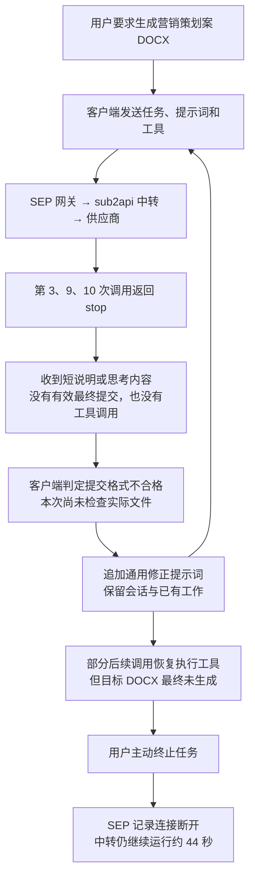
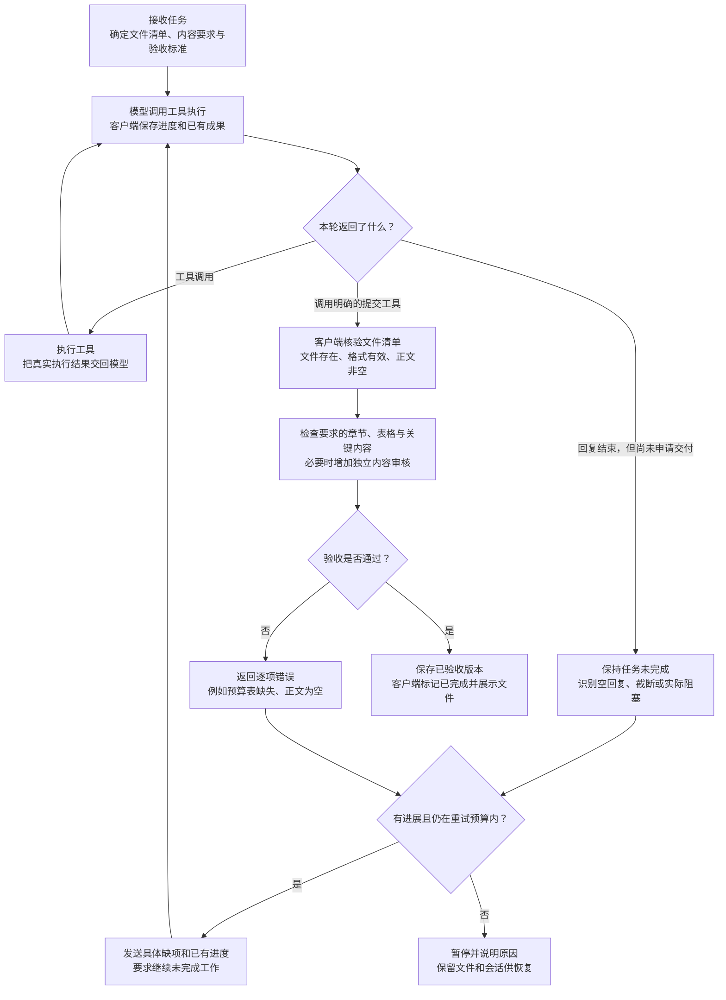

# 模型提前结束与交付验收：问题全景及正确流程

本仓库版本为脱敏摘要；请求、账单和账号关联使用稳定别名，不能直接用于生产日志检索。原始任务单和映射仅本机留存在 `outputs/model-stop-investigation-2026-10-27/private-handoff/`（未纳入 Git），需要回查时通过受控渠道取得。

日期：2026-10-27。范围：本次要求生成 DOCX 的文档编排任务。

## 一、先把三种“结束”分清楚

| 事件 | 实际含义 | 能否说明文档做好了 |
| --- | --- | --- |
| 请求成功，HTTP 200 | 请求正常建立并返回响应；流内仍可能发生错误。 | 不能。 |
| 模型返回 `stop` | 模型这一次回复结束。 | 不能。 |
| 客户端验收通过 | 对应任务要求的文件通过规定检查。 | 才能据此标记交付完成；前提是检查覆盖实际内容要求。 |

**模型负责产出和申请交付，客户端负责验收和决定完成。提示词帮助模型执行，程序检查决定任务状态。**

## 二、本次问题怎么发生的

本次有 12 次模型请求，不是 12 次全部失败。其中 3 次是重点异常 `stop`，输出用量均记录为 8704；这个相同数字不足以证明触发了输出上限。

**本次已知过程是“模型结束回复 → 客户端拒绝提交 → 继续修正”，没有证据证明客户端已经把目标文档验收为完成。** 用户所见“已结束”对应哪个具体界面状态，尚未取得事件证据。

## 三、问题分成三层

| 层级 | 已确认的事实或缺口 | 目前不能下的结论 |
| --- | --- | --- |
| 生成与传输 | 已离线复现中转兼容缺口：正文或工具只在最终完整快照中出现、没有对应增量事件时，流式转换会遗漏内容并返回 `stop`。 | 历史原始响应没有保存，不能认定这个缺口就是三次异常的根因，也不能确定供应商是否先提前停止。 |
| 执行与恢复 | 客户端把异常回复归为提交错误，主要靠通用提示词让模型修正；文档修正循环缺少通用的无进展停止规则。 | 不能把所有后续调用都说成无效重试；本次部分修正确实恢复了工具执行。 |
| 验收与展示 | 客户端检查提交清单、文件存在和格式；缺少内容完成度检查。合成实验中，正文为空的 DOCX 也能通过。 | 空正文通过是独立验证出的漏洞，不能说本次历史任务就是因此被误判完成。 |

取消也是独立问题：第 12 次请求在 SEP 记录断开后，中转继续生成并记录费用。SEP 状态为 `NEEDS_RECONCILIATION`，不能把中转费用直接当成最终用户已扣费。

## 四、现在的约束为什么不够

现在相当于：

> 提示词要求“你先写好，再交文件清单”；客户端确认清单正确、文件存在、格式能解析，然后放行。

缺少的一步是：**文件里面到底有没有用户要求的成果。**

例如，要求“市场分析、预算表、投放排期”，只检查它是不是一个合法 DOCX，不能证明这三项存在，更不能证明内容正确。

另一个问题是恢复方式：模型连文件都没写完就结束，却收到“修正提交格式”的通用提醒，不能准确表达“你还没完成文档，请从已有进度继续”。不断追加同类提示也不能保证恢复成功。

## 五、正确流程应该是什么样

这里的“提交工具”是建议新增的明确交付动作，例如 `submit_deliverables`，当前尚未实现。它比让模型在普通回复中凑一段结束 JSON 更明确，但仍然必须执行文件与内容验收。

提交验收可以异步进行：客户端先记录“验收中”，有验收结果后再完成或反馈失败。不能只因模型调用了提交工具，就直接认为文件已经合格。

内容检查应分两步：程序先检查正文、必要章节和表格等客观条件；复杂质量要求再用独立审核或用户确认补充。单纯字数达标、出现标题，仍不能代表策划案质量达标。

## 六、各部分具体负责什么

| 部分 | 正确职责 |
| --- | --- |
| 提示词 | 解释任务、工具用法、保存位置和验收要求，引导模型执行。 |
| 模型 | 生成内容、调用工具、根据具体错误修复、申请交付。 |
| 中转与网关 | 完整传递正文、思考和工具信息，正确表达终止、截断和错误，保留可追踪证据。 |
| 客户端执行器 | 区分一轮回复结束与任务完成；保存进度；分类恢复；限制连续无进展调用。 |
| 客户端验收器 | 根据真实文件和验收标准决定通过或失败，返回明确缺项。 |
| 页面 | 分别展示执行中、修复中、验收中、需处理、已取消、已完成；已完成只使用验收结果。 |
| 取消与计费链路 | 向下游传播取消，核实停止结果；未确认时保留待核对状态，独立处理用量与费用。 |

## 七、建议的修复顺序

1. **先补客户端实际缺口。** 拒绝空正文，增加必要内容检查；针对空回复、截断、文件缺失分别反馈具体错误，增加无进展与调用预算限制，状态文案与验收状态一致。
2. **修复已复现的中转缺口。** 对最终完整快照补齐未传递的内容，处理增量与快照去重，并用回放验证；不能把所有 `stop` 强制改成工具调用。
3. **补强交付协议。** 增加明确提交工具和验收回执，将任务完成状态交给客户端管理。
4. **补齐证据和取消闭环。** 在受控范围保存脱敏请求、协议事件及逐层关联 ID，定位历史问题的缺失证据；验证取消能停止下游，并核对费用。

这些修复相互补充：中转修复保证“该收到的内容能收到”，客户端修复保证“没有合格成果就不能算完成”。

## 八、本次核查依据与边界

- [平台排查报告](./平台排查报告-模型异常stop-2026-10-27.md)：生产关联、中转离线复现、取消与费用核对。
- [客户端完成判定核查](./客户端完成判定核查-模型异常stop-2026-10-27.md)：实际代码位置、7 项通过的针对性测试、正文为空 DOCX 的合成验证。
- `outputs/model-stop-investigation-2026-10-27/client-delivery-probe-results.json`（仅本机留存，未纳入 Git）：普通文字提交被拒绝、文件缺失被拒绝、空正文 DOCX 被接受。

客户端结论来自本地源码，未取得事发 Windows 安装包的准确版本。本文件整理现有证据与建议流程，没有实施业务代码修改或生产部署。
